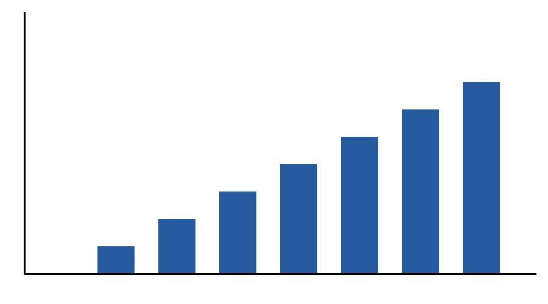

# Introduction

Dropout prediction is a recurring problem in higher education [@hastie2009]. Gradient
boosting [@friedman2001] has become a strong baseline. @fig:auc summarises the results and
@tbl:data describes the data.

# Method

## Data

Table: Dataset summary {#tbl:data}

| Cohort | Students | Dropout rate |
|:-------|---------:|-------------:|
| 2021   | 1,590    | 18.2%        |
| 2022   | 1,611    | 17.5%        |
| 2023   | 1,611    | 16.9%        |

## Model

The model minimises the loss

$$ L = \sum_{i=1}^{n} \ell\left(y_i, F(x_i)\right) + \lambda \Omega(F) $$ {#eq:loss}

where $\lambda$ controls regularisation. Minimising @eq:loss uses:

1. a learning rate of 0.05;
2. 500 trees of depth 4.

# Results

{#fig:auc alt="Bar chart: AUC rises from 0.62 for logistic regression to 0.86 for the tuned gradient boosting model." width=11cm}

# Conclusions

Gradient boosting outperformed the baseline.
